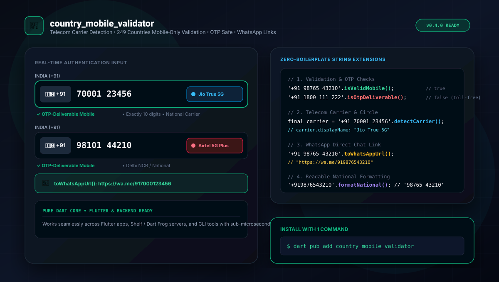

# country_mobile_validator

<p align="center">
  <a href="https://pub.dev/packages/country_mobile_validator"></a>
  <a href="https://pub.dev/packages/country_mobile_validator/score"></a>
  <a href="https://pub.dev/packages/country_mobile_validator"></a>
  <a href="https://github.com/govindtank/country_mobile_validator/actions"></a>
  <a href="LICENSE"></a>
</p>

---

<p align="center">
  
</p>

---

A high-performance, pure Dart phone number validation library with **telecom operator detection (Jio, Airtel, Vi, BSNL), 249-country mobile-only validation, SMS OTP deliverability checks, and WhatsApp click-to-chat URL generators**.

Works seamlessly in Flutter, Dart Frog / Shelf backends, and command-line tools with zero native platform dependencies.

---

## ⚡ Key Features

| Feature | Description | Real-World Benefit |
|---|---|---|
| **Telecom Carrier Detection** | Identifies cellular carrier (Jio, Airtel, Vi, BSNL) and state circle | Network-aware auth & billing |
| **Strict Mobile-Only Validation** | Rejects landlines, toll-free, and premium numbers | Saves costly failed SMS OTP sends |
| **Zero-Boilerplate Extensions** | Direct helpers on `String` (`isValidMobile()`, `detectCarrier()`) | 1-line validation |
| **WhatsApp Chat Links** | Auto-generates `toWhatsAppUrl(message: '...')` | Instant support & verification |
| **Range-Aware Accuracy** | True national ranges (e.g. AR 10–11, NZ 8–10, IN 10) | Prevents blocking valid users |
| **Sub-Microsecond Speed** | Pure Dart with zero regex during basic checks (~8 µs/op) | High-throughput backend validation |

---

## 🚀 Quick Usage

### 1. Zero-Boilerplate String Extensions

```dart
import 'package:country_mobile_validator/country_mobile_validator.dart';

// 1. Instant Mobile & OTP Deliverability Check
'+91 98765 43210'.isValidMobile();      // true
'+91 1800 111 222'.isOtpDeliverable();  // false (Toll-Free, cannot receive SMS)

// 2. Telecom Carrier & State Circle Detection
final carrier = '+91 70001 23456'.detectCarrier();
print(carrier?.displayName); // 'Jio True 5G'
print(carrier?.circle);      // 'National'

final bsnl = '+91 94220 12345'.detectCarrier();
print(bsnl?.displayName);    // 'BSNL Mobile'
print(bsnl?.circle);         // 'Maharashtra & Goa'

// 3. One-Click WhatsApp Click-to-Chat Link
final url = '+91 98765 43210'.toWhatsAppUrl(message: 'Hello Support');
// -> "https://wa.me/919876543210?text=Hello%20Support"

// 4. Clean National Formatting
'+919876543210'.formatNational(); // '98765 43210'
```

---

### 2. Global Auto-Detecting Validator

```dart
final result = validateMobile('+91 98765 43210');

if (result.isValid && result.isMobile) {
  print('Country: ${result.regionCode}'); // 'IN'
  print('E.164: +${result.countryCode}${result.nationalNumber}'); // '+919876543210'
} else {
  print('Invalid number: ${result.issue}');
}
```

---

### 3. Country-Pinned Validation (e.g. from `country_code_picker`)

```dart
final inValidator = mobileValidator.forRegion('IN');

print(inValidator.lengthHint);              // '10 digits'
print(inValidator.isMobileLength(10));      // true
print(inValidator.validate('9876543210').isValid); // true
```

---

## 💖 Support the Project

If you find this project useful, consider supporting its active maintenance and future development:

<p align="left">
  <a href="https://buymeacoffee.com/govindtanko"></a>
  <a href="https://github.com/sponsors/govindtank"></a>
  <a href="https://www.patreon.com/govindtank"></a>
</p>

---

## 📄 License

This project is licensed under the Apache License 2.0 - see the [LICENSE](LICENSE) file for details.

*Maintained with ❤️ by [Govind Tank](https://github.com/govindtank).*
